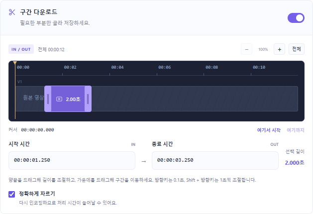

# Flow — yt-dlp Desktop

깔끔한 Windows용 yt-dlp GUI. 기본 화면에서 링크와 품질을 고르고, 필요한 부분은 타임라인에서 드래그해 저장합니다.



## Windows에서 사용하기

1. [최신 릴리스](https://github.com/mizan0515/flow-ytdlp-desktop/releases/latest)에서 **Flow-1.1-Windows.zip**을 받아 압축을 풉니다.
2. 첫 사용 전에 **Setup-Engine.cmd**를 한 번 실행합니다. 공식 yt-dlp·FFmpeg·Deno를 확인하고 앱 폴더 안에 준비합니다. 관리자 권한이나 Python 설치가 필요하지 않습니다.
3. **Flow.exe**를 실행하고 링크를 넣습니다.

Windows x64, .NET Framework 및 Microsoft Edge WebView2 Runtime을 사용합니다. 앱·DLL·ui 폴더는 함께 유지하세요. 구성요소 설치에는 인터넷 연결이 필요합니다.

## 기능

- 최고 화질·호환성 우선·오디오·MP3 프로필, 자막, 저장 폴더.
- yt-dlp **2026.10.21** 파서에서 추출한 **323개 옵션 정의 / 별칭 포함 394개 플래그**를 검색·분류·편집.
- 타임라인 양끝 드래그로 구간 줄이기·늘리기, 가운데 드래그로 길이를 유지하며 이동.
- 확대·축소·전체 맞춤, 커서로 시작·종료 지정, 직접 시간 입력.
- 방향키 0.1초, Shift+방향키 1초 조절. 구간 설정을 프리셋으로 저장.
- 작업 목록, 진행·병합 상태, 중단·재시도, 완료 파일 열기, 기록 복원.
- 엔진 조회·유지보수 도구, 반복 옵션 순서 편집, 프리셋 가져오기·내보내기.

구간 다운로드를 켜면 영상 정보를 확인해 타임라인을 표시합니다. 길이를 확인할 수 없는 영상은 시간을 직접 입력할 수 있습니다. 정확하게 자르기는 컷 경계를 재인코딩하므로 처리 시간이 늘어날 수 있습니다. 서로 다른 구간은 기본 파일명에 구간 시간이 붙습니다.

## 전체 옵션의 지원 범위

옵션 폼은 기준 버전의 실제 파서에서 생성됩니다. 모든 옵션의 입력 경로를 제공하지만 모든 사이트·계정·옵션 조합의 실행 성공을 보장하지 않습니다. 조회·표준 출력·유지보수 옵션은 **엔진 도구**에서 실행하세요. 외부 명령·플러그인 등은 실행 전 확인하며, 인증 값은 프리셋과 영구 작업 기록에서 제외합니다.

## 소스에서 빌드

Windows의 기본 .NET Framework C# 컴파일러를 사용합니다. 빌드용 WebView2 참조 준비에는 Python 3.12 이상이 필요합니다.

```powershell
python tools/prepare.py --sdk-only
powershell -NoProfile -File build.ps1
```

빌드 결과는 `dist/Flow-1.1-win-x64/Flow.exe`입니다. 엔진은 릴리스에 포함된 `Setup-Engine.cmd`로 설치하거나 `python tools/prepare.py`로 준비합니다. 기존 릴리스 폴더로 빌드하려면 `build.ps1 -OutputDirectory <폴더>`를 사용하세요. 빌드할 대상 앱은 먼저 닫아야 합니다.

## 검증

```powershell
node --test tests/frontend.test.cjs
python tests/run.py
```

전체 엔진 검증에는 구성요소를 준비해야 합니다. 실제 Windows WebView2 UI 검증은 Playwright가 필요하며 다음처럼 실행합니다.

```powershell
node tests/timeline.e2e.cjs <Playwright패키지경로> dist/Flow-1.1-win-x64 work/ui-check
```

로컬 검증: 프런트엔드 11개, 코어 343개, 실제 Windows UI 19개 확인 항목을 통과했습니다. 생성한 12초 테스트 영상에서 2초 구간을 선택한 결과가 실제 2.000초 파일인지 FFprobe로 확인했습니다. [검증 범위](docs/verification.md)를 참고하세요.

## 프로젝트 구조

| 경로 | 역할 |
| --- | --- |
| `src/App.cs` | Windows 호스트, 엔진 실행, 작업·기록 관리 |
| `ui/app.js` | 기본 화면·작업 목록·전체 옵션 GUI |
| `ui/timeline.js` | 드래그 구간 편집기 |
| `ui/core.js` | 시간 파싱·경계 검증·옵션 생성 |
| `ui/catalog.json` | 기준 엔진의 옵션 목록 |
| `tools/` | 구성요소·카탈로그·릴리스 준비 |
| `tests/` | 폼·엔진·실제 UI 검증 |

다운로드·인증 정보·앱 데이터·브라우저 프로필·엔진 바이너리는 Git에서 제외합니다. 사용할 권한이 있는 콘텐츠를 저장하세요. 외부 구성요소의 출처와 라이선스는 [THIRD-PARTY.md](THIRD-PARTY.md)를 참고하세요.
